```text
▄▄▄▄  ▀ ▄▄▄  █▄▄   ▄▄▄   ▄▄▄ ▀▀▀█ ▄▀▀▄ 
█ █ █ █ █  █ █  █ █  █  ▀▀▄▄  ▄▀  ▄▀▀▄ 
▀ ▀ ▀ ▀ ▀  ▀ ▀▀▀   ▀▀▀▀ ▀▀▀   ▀    ▀▀  
```
<sub>Made with the <a href="https://linguaholic.com/tools/ascii-art-generator/" target="_blank">`Linguaholic ASCII Art Generator`</a> · Font: “Mini Block” by Linguaholic</sub>

This is the main source code repository for the `minbas78`, aka *Minimal BASIC 1978 Compiler*, built as an homage to the classic 1978 <a href="https://ecma-international.org/publications-and-standards/standards/ecma-55/" target="_blank">STANDARD ECMA-55 Minimal BASIC</a> and <u>ANSI X3.60-1978</u> language specifications. It contains the `linux` and `Windows` (*`macOS` is coming soon...*) compilers and documentation.

```basic
10 REM IF YOU ARE NERD THEN MINBAS78
20 LET Y$ = "NERD"
30 IF Y$ = "NERD" THEN 78
78 PRINT "MINBAS78"
99 END

```

[![Crates.io][crates-badge]][crates-url]
[![APACHE licensed][apache-badge]][apache-url]
[![MIT licensed][mit-badge]][mit-url]
[![Discord chat][discord-badge]][discord-url]
[![PayPal][paypal]][paypal_donation_link]

[crates-badge]: https://img.shields.io/crates/v/minbas78.svg?logo=rust
[crates-url]: https://crates.io/crates/minbas78
[mit-badge]: https://img.shields.io/badge/license-MIT-rgb(255,127,127).svg?logo=manjaro&logoColor=rgb(255,127,127)
[mit-url]: https://github.com/minbas78/minbas78/blob/master/LICENSE-MIT
[apache-badge]: https://img.shields.io/badge/license-APACHE-orange.svg?logo=apache&logoColor=orange
[apache-url]: https://github.com/minbas78/minbas78/blob/master/LICENSE-APACHE
[discord-badge]: https://img.shields.io/discord/1566230110284292188.svg?logo=discord&color=rgb(88,101,242)
[discord-url]: https://discord.com/channels/1566230110284292188/1566230111819141225
[paypal]: https://img.shields.io/badge/Donate-PayPal-rgb(0,69,124).svg?logo=paypal&color=rgb(0,69,124)
[paypal_donation_link]: https://www.paypal.com

## Why BASIC?

- **Use:** A general-purpose, high-level programming languages designed for ease of use.

- **Target:** enable students in non-scientific fields to use computers.

- **Massive:**  for almost any system of the era became the *de facto* programming language for home computer systems that emerged in the late 1970's.

## Why Rust?

- **Performance:** Fast and memory-efficient, suitable for critical services, embedded devices, and easily integrated with other languages.

- **Reliability:** Rich type system and ownership model ensure memory and thread safety, reducing bugs at compile-time.

- **Productivity:** Comprehensive documentation, a compiler committed to providing great diagnostics, and advanced tooling including package manager and build tool, auto-formatter, linter and editor support.

## Full ECMA-55 Supported Statements

`minbas78` supports all of the ECMA-55 *grammar rules* specifications:

- `DATA` statement.
- `ABS`, `ATN`, `COS`, `EXP`, `INT`, `LOG`, `RND`, `SGN`, `SIN`, `SQR`, `TAN` *Numeric Supplied Functions*.
- `DEF` and `FN` *User Defined Functions* statements.
- `DIM`, `OPTION` and `BASE` array declarations statements.
- `END` statement.
- `GOSUB`, `RETURN`, `ON`, `GOTO`, `IF`, `THEN` and `STOP` control statements.
- `FOR` and `NEXT` statements.
- `INPUT` statement.
- `LET` statement.
- `PRINT` and `TAB` statements.
- `RANDOMIZE` statement.
- `READ` and `RESTORE` statements.
- `REM` remark statement.

## Grammar Rules

The syntax and semantic rules for interpreting the meaning of a program written in `minbas78` according to the chapters of the _1978 STANDARD ECMA-55 Minimal BASIC_.

### *Chapter 4. Characters and Strings*
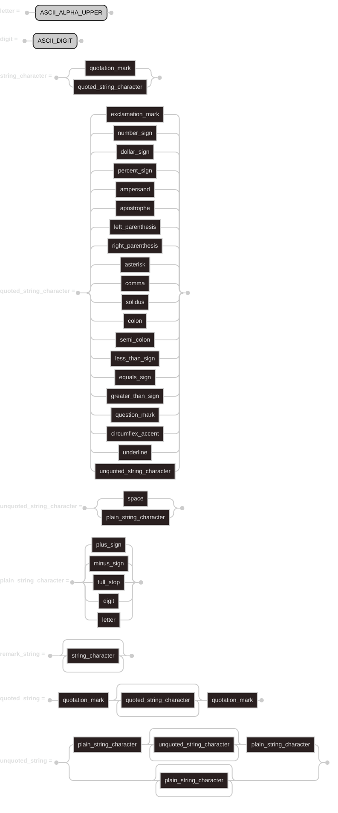

### *Chapter 5. Programs*
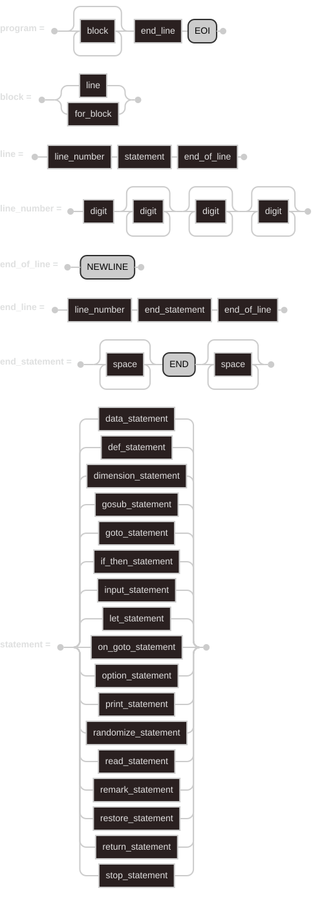

### *Chapter 6. Constants*
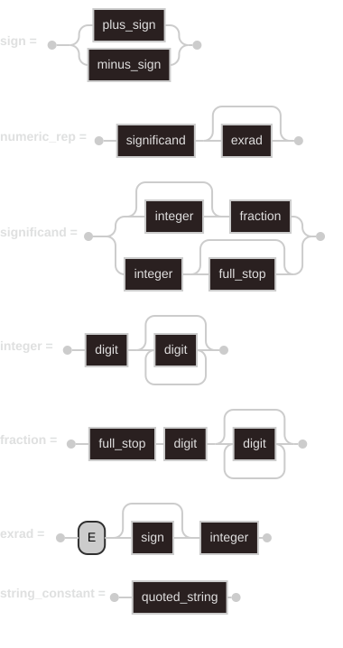

### *Chapter 7. Variables*
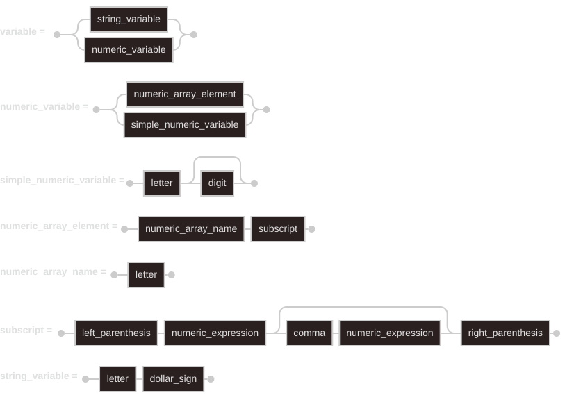

### *Chapter 8. Expressions*
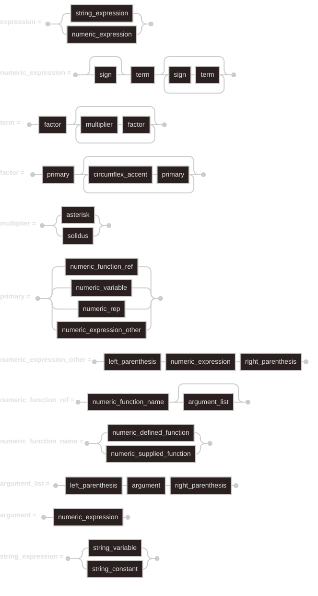

### *Chapter 9. Implementation Supplied Functions*
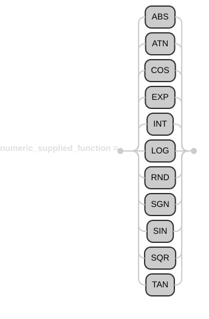

### *Chapter 10. User Defined Functions*
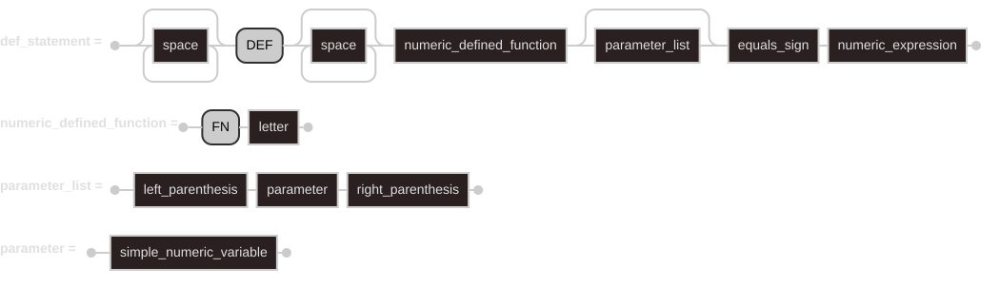

### *Chapter 11. `LET` Statement*
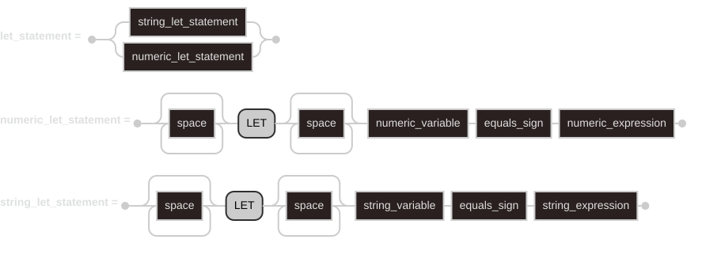

### *Chapter 12. Control Statement*
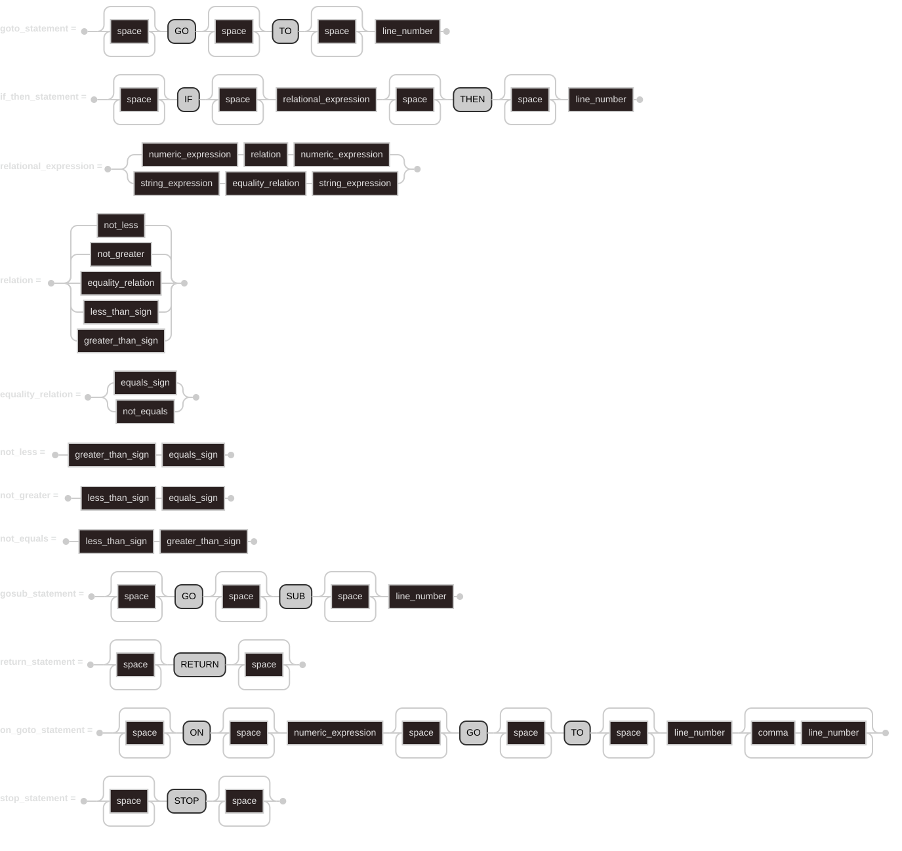

### *Chapter 13. `FOR` and `NEXT` Statements*
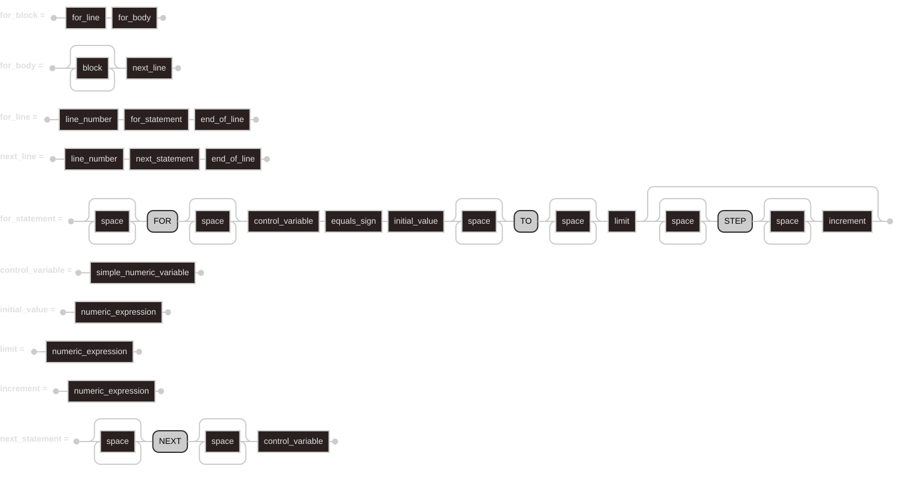

### *Chapter 14. `PRINT` statement*
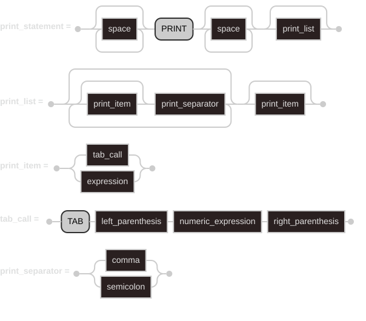

### *Chapter 15. `INPUT` statement*
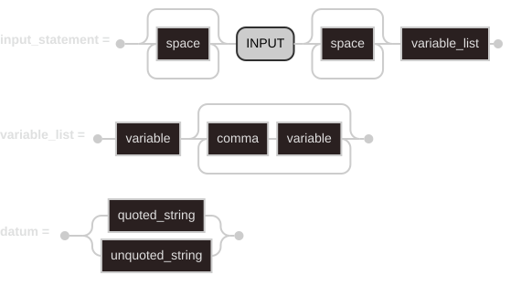

### *Chapter 16. `READ` and `RESTORE` statements*
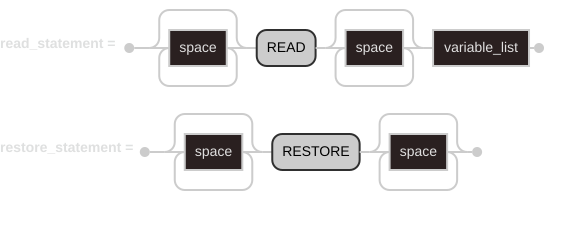

### *Chapter 17. `DATA` statement*
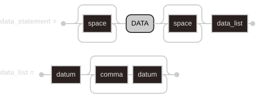

### *Chapter 18. Array Declarations*
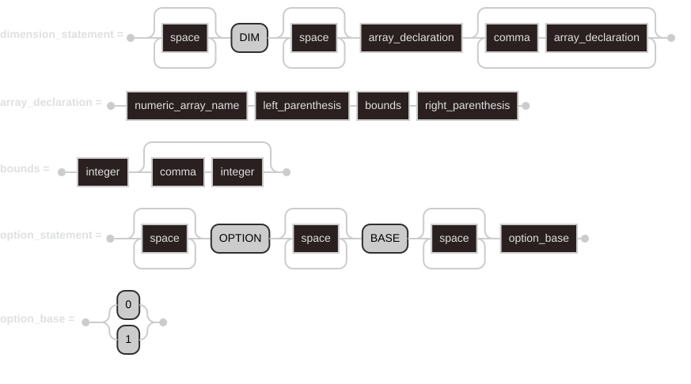

### *Chapter 19. Remark Statement*
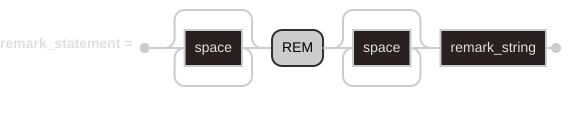

### *Chapter 20. Randomize Statement*


### *Table 1*
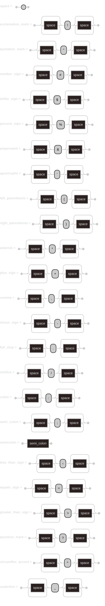

## Quick Start

The first step is to install `minbas78`. 

The following steps install the latest stable version of the `minbas78` compiler.

`minbas78`’s stability guarantees ensure that all the examples will continue to compile with newer `minbas78` versions. 

The output might differ slightly between versions because `minbas78` often improves error messages and warnings. In other words, any newer, stable version of `minbas78` you install using these steps should work as expected.

The rest of this chapter uses commands that work in _cmd.exe_.

### Command Line Notation

> <br>In this chapter and throughout the `"README.md"`, we’ll show some commands used in the terminal.
> 
> Lines that you should enter in a terminal all start with `'>'`. You
> don’t need to type the `'>'` character; it’s the command line prompt
> shown to indicate the start of each command.
> 
> Lines that don’t start with `'>'` typically show the output of the previous command.
> <br>
> <br>

## Installation

### Linux

You can download the latest binary release `minbas78-a.b.c-x86_64-unknown-linux-musl.tar.gz` from <a href="https://github.com/minbas78/minbas78/releases/latest/" target="_blank">GitHub</a> latest releases and tags. You’ll need
an internet connection for the download and replace the `a.b.c` version you prefer.

```batch
> curl -L "https://github.com/minbas78/minbas78/releases/download/va.b.c/minbas78-a.b.c-x86_64-unknown-linux-musl.tar.gz"
```
The `gpg` command line script for verifying the `minbas78` versions and associated tools:

```batch
> gpg --no-default-keyring --keyring minbas78.asc --verify minbas78-a.b.c-x86_64-unknown-linux-musl.tar.gz.asc minbas78-a.b.c-x86_64-unknown-linux-musl.tar.gz
```
The `tar` command line script for unzip the `minbas78` compiler and library:

```batch
> tar -xf minbas78-a.b.c-x86_64-unknown-linux-musl.tar.gz
```

The command line scripts for compile and execute the `Dartmouth first 1964-05-01 BASIC` source code file with the `minbas78` compiler and library:

```batch
> cat examples/DARTMOUTH_FIRST_1964_05_01.bas
10 PRINT 2+2
20 END

> ./minbas78 examples/DARTMOUTH_FIRST_1964_05_01.bas
> ./examples/DARTMOUTH_FIRST_1964_05_01
 4
> 
```

### Windows

You can download the latest binary release `minbas78-a.b.c-x86_64-pc-windows-msvc.zip` from <a href="https://github.com/minbas78/minbas78/releases/latest/" target="_blank">GitHub</a> latest releases and tags. You’ll need
an internet connection for the download and replace the `a.b.c` version you prefer.

```batch
> curl -L "https://github.com/minbas78/minbas78/releases/download/va.b.c/minbas78-a.b.c-x86_64-pc-windows-msvc.zip"
```
The `gpg` command line script for verifying the `minbas78` versions and associated tools:

```batch
> gpg --no-default-keyring --keyring minbas78.asc --verify minbas78-a.b.c-x86_64-pc-windows-msvc.zip.asc minbas78-a.b.c-x86_64-pc-windows-msvc.zip
```
The `tar` command line script for unzip the `minbas78` compiler and library:

```batch
> tar -xf minbas78-a.b.c-x86_64-pc-windows-msvc.zip
```

The command line scripts for compile and execute the `Dartmouth first 1964-05-01 BASIC` source code file with the `minbas78` compiler and library:

```batch
> type examples\DARTMOUTH_FIRST_1964_05_01.bas
10 PRINT 2+2
20 END

> minbas78.exe examples\DARTMOUTH_FIRST_1964_05_01.bas
> examples\DARTMOUTH_FIRST_1964_05_01.exe
 4
> 
```

### Troubleshooting

To check whether you have `minbas78` installed correctly, open a shell and enter this line:

```batch
> minbas78 --version
```

You should see the `minbas78` banner, the version number, commit hash, and commit date for the latest
stable version that has been released, in the following format:

```text
▄▄▄▄  ▀ ▄▄▄  █▄▄   ▄▄▄   ▄▄▄ ▀▀▀█ ▄▀▀▄ 
█ █ █ █ █  █ █  █ █  █  ▀▀▄▄  ▄▀  ▄▀▀▄ 
▀ ▀ ▀ ▀ ▀  ▀ ▀▀▀   ▀▀▀▀ ▀▀▀   ▀    ▀▀  
minbas78 x.y.z (abcabcabc yyyy-mm-dd)
```

If you see this information, you have installed `minbas78` successfully! 

If that’s all correct and `minbas78` still isn’t working, you can get help in the <a href="https://discord.com/channels/1566230110284292188/1566230111819141223" target="_blank">minbas78 Discord Server</a>.

### Updating and Uninstalling

Once `minbas78` is installed, updating to a newly released version is
easy. Download the new release and repeat the installation steps.

To uninstall `minbas78`, delete the folder where the compiler is located.

## Installing from Source

If you really want to install from source (though this is not recommended), clone the `minbas78` from `github`:

```batch
> git clone https://github.com/minbas78/minbas78.git
```

## Getting Help

Go to the <a href="https://discord.com/channels/1566230110284292188/1566230111819141223" target="_blank">minbas78 Discord Server</a> for help.

## License

`minbas78` is primarily distributed under the terms of both the MIT license and the Apache License (Version 2.0).

See [LICENSE-APACHE](LICENSE-APACHE), [LICENSE-MIT](LICENSE-MIT), and
[COPYRIGHT](./COPYRIGHT) for details.

## Trademarks

- <a href="https://linguaholic.com/tools/ascii-art-generator/" target="_blank">`Linguaholic Mini Block`</a>

- Another third-party libraries may be subject to third-party copyrights and trademarks. 
